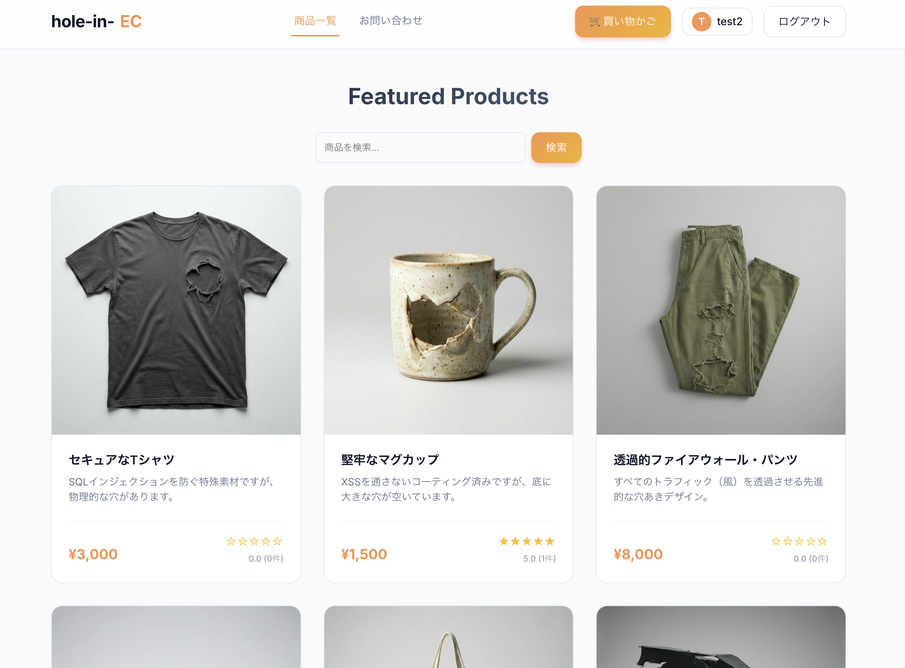
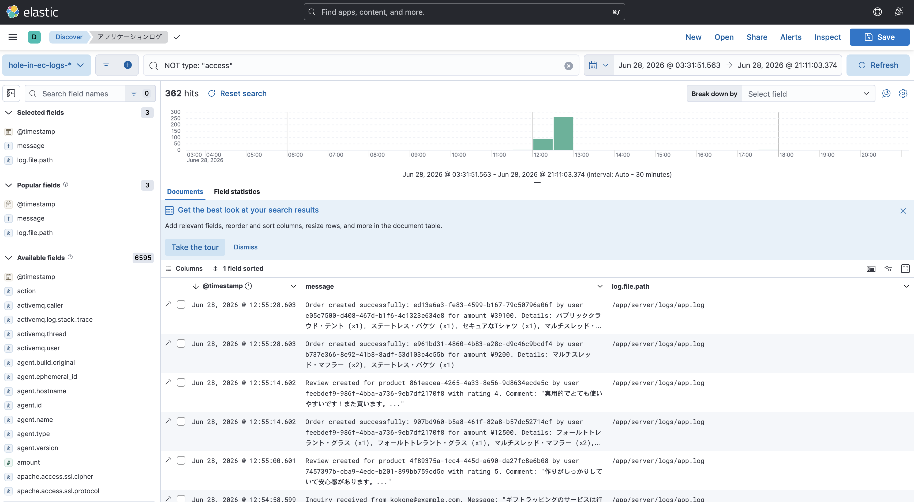

# 🚀 セキュア開発・運用ワークショップ オープニング・ガイダンス

本ドキュメントは、ワークショップ開始時にインストラクターが説明する「オープニング＆オリエンテーション」のスライドノート、および参加者への案内用導入資料です。

---

## 1. ワークショップの背景とコンセプト

従来のシステム開発・運用では、以下のような「セキュリティの分断」がよく起きていました。

*   **開発チーム**: 機能要件（動くこと）を重視し、セキュリティの実装やログ設計は後回しになりがち。
*   **セキュリティ/運用チーム**: ログ監視でアラートを検知するが、コードの中身や具体的な修正方法はわからない。

本ワークショップでは、参加者の皆様に**「開発と運用の両方の視点」**を持っていただき、**「ログから攻撃を検知し、コードを修正してデプロイし、復旧する」というDevSecOpsの一連のライフサイクル**を実践していただきます。

---

## 2. ストーリー設定 (インシデント発生)

> ### 🚨 ミッション：謎のインシデントを調査し、強固に守り抜け！
>
> あなたが開発・運用を担当しているECサイト「**hole-in-EC**」がローンチされました。
> 現在、不審なログが多数検知されており、不幸なことに**まさに今日、このシステムは攻撃を受けることになります。**
>
> あなたたちのチームの任務は、バグのあるソースコードの特定・修正はもちろん大切ですが、それ以上に**「どの脆弱性を突かれたのか？」「どのような影響（被害）があったのか？」「脆弱性は正しく修正できたのか？」を、誰もが納得いく形で調査・報告すること**です。

---

## 3. 課題解決と報告のために駆使する環境・ツール群

本ワークショップでは、インシデントの全容を調査し、コードを修正し、最終的な調査報告を完成させるために、以下の**4つの強力な環境・ツール**が提供されています。これらを自由に駆使して、問題解決とレポート作成を進めてください。

1.  **ログ監視基盤 (Kibana)**:
    サーバーから集約されたログを頼りに、攻撃の発生（検知）、何が起きたか（影響）、いつ起きたか（タイムライン）の**決定的な証跡（エビデンス）**を調査・抽出するために使用します。
2.  **共同開発環境 (GitHub Codespaces / Live Share)**:
    チームメンバーがリアルタイムに1つのエディタに同時に入り、コードレベルの脆弱性（原因）を特定し、議論しながらプログラムを修正・セキュア化するために使用します。
3.  **自動デプロイ ＆ テスト検証 (GitHub Actions / Jest)**:
    修正したコードを `git push` するだけで、AWS上のサーバーに即時デプロイされ、自動でテストが走る仕組みです。適用した対策が本当に正しく機能しているか（防御できたか）を検証するために使用します。
4.  **インシデント報告テンプレート (`docs/incident_report_template.md`)**:
    調査・修正した結果を、誰もが納得いく形でまとめるためのアプトプットフォーマットです。インシデントの概要、ログの証跡、Before/Afterのソースコード、適用した対策の理由を整理して報告書として提出します。

---

## 4. はじめの一歩：環境の準備と確認

競技を開始する前に、各チームで以下の3つの環境へアクセスできるか順番に確認してください。

### ① 🛍️ やられECサイト (hole-in-EC)

1.  配布されたECサイトのデプロイ先URL（フロントエンド画面）を開きます。
2.  このサイトは「意図的に脆弱性が残されたやられサイト」です。実際に商品を見たりカートに入れたりして、どのようなサイトであるかを確認してください。

### ② 📊 ログ監視環境 (Elasticsearch / Kibana)

*   **どのような環境か**: 
    アプリケーションやWebサーバーから出力されたログをリアルタイムに集約し、検索や可視化（グラフ化）を行える強力なログ解析プラットフォームです。
*   **本ワークショップでの役割**: 
    Kibana の **Discover** 画面などを使い、攻撃者がどのAPIを叩いたか、どのようなパラメータを送ってきたか、情報の漏えいや不正購入による具体的な被害影響がどれほどあったかの「決定的な証跡（エビデンス）」を調査するために使用します。
    *   *具体的なアクセス方法や詳細な見方は、[Kibana ログ分析・設定手順書](../1_opening/2_Elasticsearch設定.md) を確認してください。*

### ③ 💻 開発・エディタ環境 (GitHub Codespaces)

*   **どのような環境か**: 
    クラウド上で動作する、ブラウザからアクセス可能な統合開発環境（VS Code）です。
*   **本ワークショップでの役割**: 
    メンバー全員がリアルタイムに同じコードを同時に編集・レビューできる **Live Share** 機能を提供します。手元のパソコンへの環境構築を一切行うことなく、チームで議論しながらソースコードの特定・修正をブラウザだけで実施できます。
    *   *具体的な起動方法や Live Share の接続手順は、[Codespaces 利用ガイド](../1_opening/3_codespaces_guide.md) を確認してください。*

### ④ 📝 インシデント報告書テンプレート (docs/4_report/incident_report_template.md)
*   **どのようなファイルか**: 
    各グループが調査・対策して得られた成果（発見した脆弱性、インシデントの被害影響、証拠となったログ、修正したコード差分など）を整理して報告するためのMarkdownフォーマットです。
*   **本ワークショップでの役割**: 
    本ミッションの最終的な成果物です。単に「バグを直して終わり」にするのではなく、**「どのような攻撃ログを証拠として発見し、どんなビジネス上の被害影響があり、なぜその修正で防げるのか」を、他のメンバーや運営が納得できる形で論理的に報告すること**が最も重視されます。
    *   *※ リポジトリ内の `docs/4_report/incident_report_template.md` に格納されています。各自のCodespace上でコピーして、チームのディスカッションメモを兼ねて編集・提出してください。*

---

## 5. チームビルディングと役割分担（推奨）

競技を円滑に進め、お互いの強みを活かすために、まずはチーム内でのコミュニケーションからスタートしましょう！

### ① まずは自己紹介（アイスブレイク）
チームメンバー同士で、以下の内容を簡単に自己紹介（1人1〜2分程度）してください。
*   **お名前（ニックネーム）**
*   **普段の担当業務や得意な領域**（開発、インフラ、運用、テスト、セキュリティ等）
*   **本日やってみたい役割や意気込み**（「ログをガッツリ追いかけてみたい！」「Codespacesを動かしてコード修正を書きたい！」など）

### ② ゆるやかな役割分担
チーム内で、以下のような役割を割り振ってみてください（※完全に固定せず、お互いに助け合いながら共同で進めてください）。

*   **ログアナリスト (1〜2名)**: Kibana を監視し、不審なIPや攻撃の検知、攻撃者がたどったタイムラインの分析を担当。
*   **セキュアデベロッパー (1〜2名)**: Codespaces を動かし、脆弱性のあるソースコードの特定と、セキュアコーディングによる修正を担当。

---

## 🛡️ ワークショップのルール
*   **業務情報の持ち込みは絶対禁止**:
    実際の自社のソースコード、社外秘の資料、本番の認証情報（鍵）など、**実業務の機密情報を絶対にこの演習環境（Codespacesやチャット等）へ持ち込まない（アップロードしない）でください。**
*   **AI (生成AI) の利用制限について**:
    実装の相談などでChatGPT等のAIを使用することは可能ですが、**やられアプリ（hole-in-EC）のソースコード全体を丸ごと外部AIへ食わせる（アップロードする）ことは一旦お控えください。**
    「AIをいかに安全に開発に活用するか」については、後半のクロージングにてみんなで一緒に解説・実践します。
*   **意図的な環境破壊の禁止**:
    脆弱性の調査や対策のために様々な試行錯誤を行うことは歓迎しますが、**意図的にデータベースを全消去して復旧不能にしたり、監視基盤（Kibana等）をクラッシュさせたりするような破壊的行為は行わないでください。**
